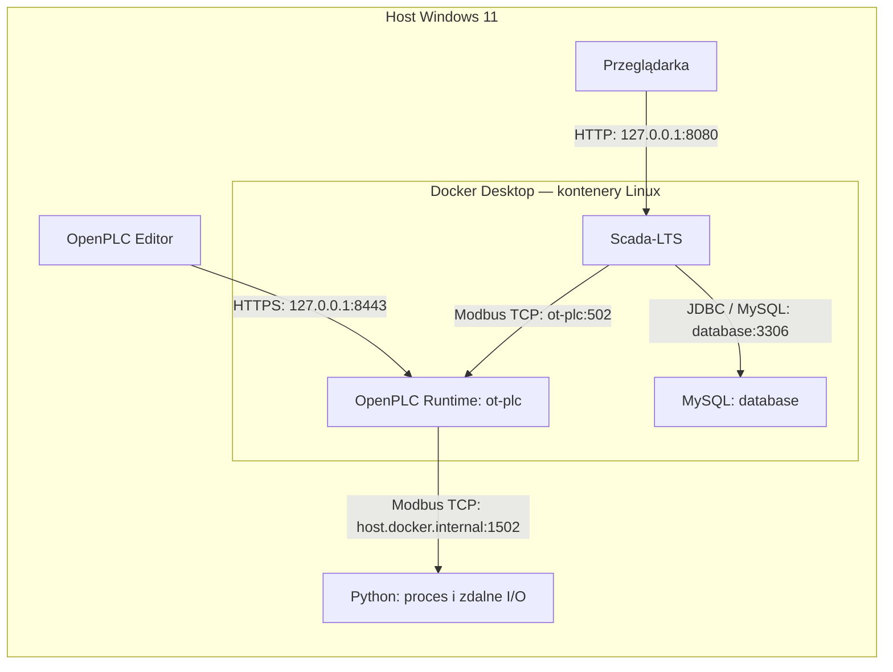

# Cele projektu

1. Stworzenie lokalnej, niefizycznej symulacji prostego procesu technologicznego ICS/OT, wraz z HMI i typowymi zabezpieczeniami przed cyberatakami.
2. Użycie stworzonej symulacji do analizy podatności oraz przeprowadzeniu przykładowych ataków w celu zobrazowania tych podatności
3. Analiza potencjalnych rozwiązań w celu zapobiegania atakom (np. dodanie diody danych)
4. Analiza architektury pod względem zgodności z popularnymi standardami cyberbezpieczeństwa ICS/OT


# Architektura projektu PLCSim

Podstawowym procesem opisywanym przez PLCSim jest sterowanie poziomem wody w zbiorniku (skrypt python)
za pomocą sterownika PLC (OpenPLC) z wizualizacją (Scada LTS) oraz kontrolą (Suricata).

## 1. Komponenty i ich role

### 1.1. Model procesu

Skrypt w pythonie oblicza bilans objętości wody w zbiorniku: dopływ minus odpływ. 
Przy włączonej pompie objętość rośnie netto o 6 l/s, a przy wyłączonej maleje o 2 l/s. 
Nadmiar ponad pojemność jest rejestrowany jako przelew w `spilled_total_l`. 

Do bilansu używany jest faktyczny czas między aktualizacjami, mierzony przez `time.monotonic()`. 
Windows i Docker nie zapewniają tu ścisłych gwarancji czasowych. Zmiana polecenia pompy (on/off) 
odebrana w trakcie kroku modelu jest uwzględniana dopiero w kolejnym cyklu obliczeń.

Powiązane pliki:
[process.py](../process.py) zawiera klasę `Tank`, a
[process_server.py](../process_server.py) uruchamia model razem z serwerem Modbus.

### 1.2. Regulator PLC

Program [main.st](../TankControl/pous/programs/main.st) jest napisany
w Structured Text i przypisany do zadania `task0` o okresie `T#20ms`:

- przy poziomie nie większym niż 40% włącza pompę;
- przy poziomie nie mniejszym niż 60% wyłącza pompę;
- pomiędzy progami zachowuje poprzedni stan polecenia.

Zmienna `LevelRaw` przechowuje pomiar całkowitoliczbowy, `LevelPct` jego przeliczenie
na procenty, a `PumpCmd` polecenie logiczne. Przykładowo `5037` oznacza 50,37%.
Cykl programu PLC wynosi 20 ms, natomiast wymiana z procesem jest konfigurowana
co 100 ms. Te dwie częstotliwości nie są tym samym.

### 1.3. HMI

Scada-LTS korzysta ze źródła `OpenPLC_Tank` i dwóch punktów:

| Punkt | Źródło | Interpretacja |
|---|---|---|
| `Tank_Level` | Input Register 0 w PLC | Liczba 16-bitowa bez znaku, mnożnik `0.01`, wynik w procentach. |
| `Tank_PumpCmd` | Coil 0 w PLC | Polecenie pompy: wyłączona/włączona. |

Obecna Watch List z wartościami i wykresem już pełni funkcję prostego HMI, ale można dodać interfejs graficzny.
`Tank_PumpCmd` pokazuje polecenie sterownika, a nie niezależny pomiar rzeczywistej
pracy urządzenia. HMI widzi pomiar dostępny w PLC; podczas eksperymentów może on
różnić się od rzeczywistego stanu modelu w Pythonie.


## 2. Hosting i połączenia

### 2.1. Rozmieszczenie

| Element | Miejsce uruchomienia | Konfiguracja |
|---|---|---|
| Symulator procesu | Skrypt na hoście Windows, środowisko `.venv` | `process_server.py`, nasłuch `0.0.0.0:1502`. |
| PLC | Kontener Linux `ot-plc` w Docker Desktop | Używany obraz lokalny `ot-lab/openplc-runtime:baseline`; projekt znajduje się w `TankControl/`. |
| OpenPLC Editor | Aplikacja na Windowsie | Zarządza Runtime pod `127.0.0.1:8443`. |
| HMI | Usługa `scadalts` projektu Compose `ot-hmi` | Obraz `scadalts/scadalts:latest`, kontener przy domyślnym nazewnictwie `ot-hmi-scadalts-1`. |
| Baza HMI | Usługa `database` tego samego projektu Compose | Kontener `ot-hmi-database-1`, baza `scadalts`. |
| Przeglądarka | Aplikacja na Windowsie | Otwiera HMI przez lokalny port 8080. |

Obraz PLC o nazwie `baseline` jest tagiem lokalnym, a nie numerem wydania
Runtime.

### 2.2. Schemat komunikacji

Strzałki przedstawiają inicjowanie połączeń; odpowiedzi wracają tymi samymi
połączeniami. Uproszczono wewnętrzną warstwę sieciową Docker Desktop.



| Inicjator → odbiorca | Protokół i port docelowy | Cel |
|---|---|---|
| PLC → proces | Modbus TCP, `host.docker.internal:1502` | FC04 odczytuje poziom, FC05 zapisuje polecenie pompy. |
| HMI → PLC | Modbus TCP, `ot-plc:502` | FC04 odczytuje poziom, FC01 odczytuje polecenie pompy. |
| Editor → PLC | HTTPS/API, `127.0.0.1:8443` | Przesyłanie programu, uwierzytelnienie, start/stop i debugowanie. |
| Przeglądarka → HMI | HTTP, `127.0.0.1:8080` | Interfejs pod `/Scada-LTS/`. |
| HMI → MySQL | JDBC / protokół MySQL, `database:3306` | Konfiguracja, historia i zdarzenia. |

Port 1502 należy do serwera procesu, a port 502 do serwera w PLC. 
PLC pełni więc równocześnie rolę klienta i serwera Modbus, ale dla dwóch różnych połączeń.

### 2.4. Mapa danych i przebieg sterowania

| Sygnał | Proces Python | Obraz I/O i zmienna PLC | Udostępnienie dla HMI |
|---|---|---|---|
| Poziom | Input Register `0`, zakres `0–10000` | Alias `TankLevelInput`, `%IW0`, `LevelRaw` | Input Register `0`; przeliczenie `× 0.01`. |
| Pompa | Coil `0`, `False/True` | Alias `TankPumpOutput`, `%QX0.0`, `PumpCmd` | Coil `0`; odczyt polecenia. |

Adresy w tabeli są adresami protokołu liczonymi od zera. Rejestr 0 i coil 0
należą do odrębnych przestrzeni. 

1. Python oblicza poziom i publikuje go w swoim banku danych.
2. Konfiguracja `TankIO` odczytuje pomiar do obrazu wejść PLC.
3. Program ST oblicza `PumpCmd` na podstawie histerezy.
4. `TankIO` przesyła polecenie do coil 0 procesu.
5. Python uwzględnia polecenie w kolejnym cyklu modelu.
6. Scada-LTS niezależnie odczytuje obraz I/O PLC, nominalnie co 500 ms.

Scada-LTS nie jest częścią pętli regulacji. Zatrzymanie HMI nie powinno zatrzymać
PLC ani procesu.

## 3. Stan projektu i dalsze prace

### 3.1. Zrealizowane

- Działający model zbiornika, pompy, odpływu i przelewu w Pythonie.
- Projekt OpenPLC z regulatorem z histerezą.
- Działająca pętla Python ↔ OpenPLC przez Modbus TCP.
- Serwer Modbus w PLC udostępniający dane dla HMI.

### 3.2. Do zrobienia

- Suricata
- Firewall
- Watchdog w skrypcie python

## 4. Struktura folderów i plików

Drzewo pokazuje pliki obecne podczas przygotowania dokumentacji oraz niniejszy
dokument. Wnętrze środowiska Pythona i katalogów pamięci podręcznej pominięto.

```text
PLCSim/
├── docs/
│   └── ARCHITEKTURA.md
├── hmi/
│   ├── compose.yaml
│   └── README.md
├── TankControl/
│   ├── project.json
│   ├── devices/
│   │   ├── configuration.json
│   │   ├── pin-mapping.json
│   │   ├── remote/
│   │   │   └── TankIO.json
│   │   └── servers/
│   │       └── TankHmi.json
│   └── pous/
│       └── programs/
│           └── main.st
├── old/
│   ├── controller.py
│   ├── process.py
│   ├── tank.py
│   └── measurements.csv
├── .venv/                 # lokalne środowisko Pythona
├── __pycache__/           # wygenerowany kod bajtowy Pythona
├── controller.py
├── controller_client.py
├── process.py
├── process_server.py
├── requirements.txt
├── measurements_modbus.csv
├── modbus_measurements.csv
└── README.md
```

### 4.1. Główny katalog

| Plik / folder | Funkcja |
|---|---|
| `README.md` | Punkt wejścia do projektu, krótki opis i odnośniki do dokumentacji. |
| `process.py` | Klasa `Tank`: stan i fizyka uproszczonego procesu; bez logiki sterowania i bez sieci. |
| `process_server.py` | Główny program procesu: uruchamia serwer Modbus, pobiera polecenie, aktualizuje model i zapisuje CSV. |
| `controller.py` | Regulator z histerezą w Pythonie, używany w poprzednim ćwiczeniu. W obecnym wariancie steruje PLC. |
| `controller_client.py` | Alternatywny klient Modbus wykonujący regulator Pythona. Nie uruchamiać równocześnie z regulatorem OpenPLC: oba zapisują tę samą pompę. |
| `requirements.txt` | Zależności Pythona; obecnie `pyModbusTCP==0.3.0`. |
| `modbus_measurements.csv` | Plik zapisywany przez obecny `process_server.py`: czas, poziom, polecenie pompy użyte w kroku i łączny przelew. Każdy start nadpisuje plik. |
| `measurements_modbus.csv` | Zachowany zapis wcześniejszego przebiegu z dodatkowymi kolumnami czasu kroku i objętości. Bieżący serwer nie zapisuje pod tą nazwą. |
| `.venv/` | Lokalny interpreter i zainstalowane zależności; środowisko odtwarzalne z `requirements.txt`. |
| `__pycache__/` | Automatycznie generowane pliki `.pyc`; nie są kodem źródłowym ani wynikami badań. |

### 4.2. Projekt OpenPLC: `TankControl/`

| Ścieżka | Funkcja |
|---|---|
| `project.json` | Metadane, zadanie `task0`, instancja `main` oraz lista zmiennych debugowanych. Kod programu jest przechowywany oddzielnie. |
| `devices/configuration.json` | Wybór Runtime v4 i adres zarządzania `127.0.0.1` używany przez Editor. |
| `devices/pin-mapping.json` | Konfiguracja mapowania sprzętowych pinów; obecnie pusty obiekt, ponieważ projekt nie używa fizycznego I/O. |
| `devices/remote/TankIO.json` | Klient Modbus do procesu: host, port 1502, Unit ID 1, grupy FC04/FC05, okresy, adresy i aliasy. |
| `devices/servers/TankHmi.json` | Włączenie serwera Modbus dla HMI na `0.0.0.0:502`. Plik nie zawiera jawnie wszystkich domyślnych parametrów mapowania Runtime. |
| `pous/programs/main.st` | Program ST: skalowanie poziomu oraz regulator z progami 40% i 60%; zmienne powiązane z aliasami `TankIO`. |

Konfigurację projektu najlepiej zmieniać w Editorze, aby zachować spójność
aliasów, mapowania i artefaktów kompilacji. Samo zapisanie plików nie aktualizuje
programu w kontenerze: potrzebne jest zbudowanie i przesłanie projektu.

### 4.3. HMI: `hmi/`

- `compose.yaml` opisuje usługi Scada-LTS i MySQL, zależność od gotowości bazy,
  wolumen danych oraz sieci `backend` i `ot-supervision`. Nie tworzy kontenera PLC.
- `README.md` zawiera instrukcję konfiguracji serwera PLC, źródła Modbus,
  punktów HMI, limitów odczytu oraz propozycje widoków i alarmów. Obecność
  instrukcji nie oznacza, że wszystkie opisane opcje zostały już wdrożone.